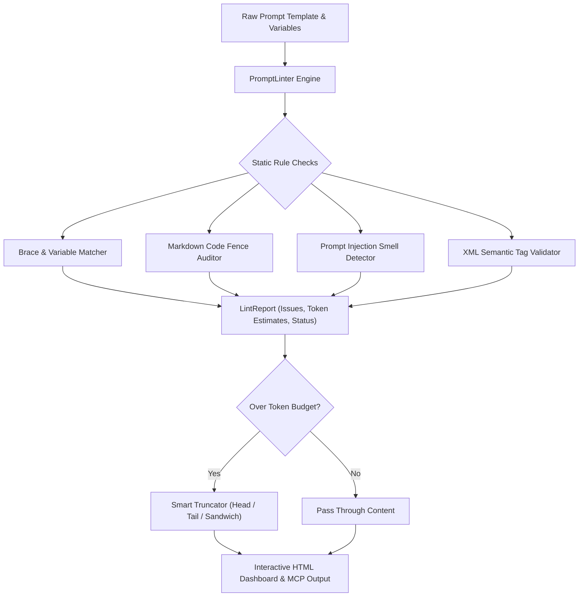

# Prompt Context Linter & Formatter

> A deterministic static analysis toolkit, smell detector, and token-aware context truncator designed for AI prompt templates, structured context builders, and Model Context Protocol (FastMCP) pipelines.

---

## Overview

### Problem Statement & Intended Users
- **Problem**: In production agent pipelines, prompt templates often suffer from silent failures: unclosed braces cause runtime string interpolation errors, unclosed markdown fences corrupt tool parsing, dangling variables leak into LLM system prompts, and unmanaged document growth overflows model context windows.
- **Intended Users**: Prompt engineers, agent developers, LLM ops engineers, and automated CI/CD test pipelines ensuring prompt template quality and token efficiency.

### Key Features
- **Deterministic Static Linting**: Catches unbalanced braces, dangling variables, unused variables, and unclosed XML tags without external dependencies.
- **Markdown & Code Fence Balance**: Ensures triple backticks (` ``` `) and markdown block fences are correctly paired.
- **Prompt Injection & Smell Detection**: Identifies instruction override smells (`"ignore all previous instructions"`, simulated system escalation, privilege escape markers).
- **Smart Budget Truncator**: Truncates long contexts using `head`, `tail`, or `sandwich` strategies while maintaining markdown fence validity and inserting clear audit markers.
- **Modular Context Formatter**: Builds structured prompts from persona, instructions, tool schemas, exemplars, and context documents in Markdown or XML delimiter styles.
- **Interactive Glassmorphism Dashboard**: Generates self-contained HTML reports with issue cards, variable matrices, token estimates, and OWASP XSS defense.
- **FastMCP Protocol Integration**: Exposes `lint_prompt_template`, `format_agent_context`, and `truncate_context_budget` directly to agent orchestrators and IDEs.

---

## Technical Stack

- **Language & Runtime**: Python 3.10+ (Tested on Python 3.13)
- **Agent Framework / Protocol**: Model Context Protocol (`mcp` FastMCP)
- **Validation & Modeling**: `pydantic>=2.0.0`
- **Testing**: `pytest>=8.0.0` (16 clean-room tests passing)
- **External Dependencies**: Zero mandatory API keys or cloud dependencies

---

## Architecture & Data Flow



---

## Prerequisites

- Python 3.10 or higher
- `pip` or virtual environment manager
- Zero external API keys needed (operates fully locally and deterministically)

---

## Installation & Setup

1. **Navigate to the tool directory:**
   ```bash
   cd tools/prompt-context-linter
   ```

2. **Create and activate a virtual environment (optional):**
   ```bash
   python -m venv .venv
   # Windows:
   .venv\Scripts\activate
   # Linux/macOS:
   source .venv/bin/activate
   ```

3. **Install dependencies:**
   ```bash
   pip install -r requirements.txt
   ```

---

## Usage Instructions

### 1. Linting a Valid Prompt Template
```bash
python main.py --file examples/valid_template.txt --vars examples/sample_variables.json --output-html lint_report.html
```

### 2. Linting a Template with Smells (Strict Mode)
```bash
python main.py --file examples/broken_template.txt --strict
```

### 3. Truncating to a Strict Token Budget
```bash
python main.py --file examples/valid_template.txt --vars examples/sample_variables.json --max-tokens 50 --policy sandwich
```

### 4. Running FastMCP Server
```bash
# Verify tool registration:
python mcp_server.py --test

# Run stdio server:
python mcp_server.py
```

---

## Run Inputs & Outputs

### Sample Command
```bash
python main.py --file examples/valid_template.txt --vars examples/sample_variables.json
```

### Sample Terminal Output
```
======================================================================
   PROMPT CONTEXT LINTER & FORMATTER
======================================================================
 Template Target   : examples/valid_template.txt
 Variables File    : examples/sample_variables.json
 Strict Mode       : False
 Max Token Budget  : Unlimited
======================================================================

[Linter Status] VALID | Issues Found: 0
Tokens Estimate: ~81 | Characters: 308

[Dashboard] Report written to: lint_report.html

======================================================================
 RESULT: PASSED
======================================================================
```

---

## Testing & Verification

Run the automated test suite covering all lint rules, Markdown fence balancing, truncation policies, and HTML dashboard generation:

```bash
python -m pytest tests/ -v
```

**Verification Results:**
```
tools/prompt-context-linter/tests/test_dashboard.py::test_html_dashboard_generation PASSED
tools/prompt-context-linter/tests/test_dashboard.py::test_dashboard_xss_protection PASSED
tools/prompt-context-linter/tests/test_formatter.py::test_markdown_formatting PASSED
tools/prompt-context-linter/tests/test_formatter.py::test_xml_formatting PASSED
tools/prompt-context-linter/tests/test_linter.py::test_valid_template_passes PASSED
tools/prompt-context-linter/tests/test_linter.py::test_unbalanced_braces PASSED
tools/prompt-context-linter/tests/test_linter.py::test_missing_variable_strict PASSED
tools/prompt-context-linter/tests/test_linter.py::test_unclosed_code_blocks PASSED
tools/prompt-context-linter/tests/test_linter.py::test_injection_smell_detection PASSED
tools/prompt-context-linter/tests/test_linter.py::test_unbalanced_tags PASSED
tools/prompt-context-linter/tests/test_linter.py::test_estimate_tokens PASSED
tools/prompt-context-linter/tests/test_truncator.py::test_text_within_budget_untouched PASSED
tools/prompt-context-linter/tests/test_truncator.py::test_head_truncation PASSED
tools/prompt-context-linter/tests/test_truncator.py::test_tail_truncation PASSED
tools/prompt-context-linter/tests/test_truncator.py::test_sandwich_truncation PASSED
tools/prompt-context-linter/tests/test_truncator.py::test_markdown_fence_balancing PASSED
============================= 16 passed in 0.15s ==============================
```

---

## Token Considerations & Cost Optimization

- **Zero API Invocations**: The linter uses local regular expressions and deterministic AST/string algorithms, generating $0.00 in LLM costs.
- **Token Truncation Savings**: Prevents expensive token overflow errors before dispatching prompts to frontier models (e.g., GPT-4o, Claude 3.5 Sonnet, Gemini 2.5 Flash).

---

## Security & Zero Secrets Compliance

- Adheres strictly to the repository's **Zero Secrets Policy**: `.env` and local credentials are fully ignored by `.gitignore`.
- Does not modify any root build files or touch files outside `tools/prompt-context-linter/` (other than registration in `tools/README.md`).
