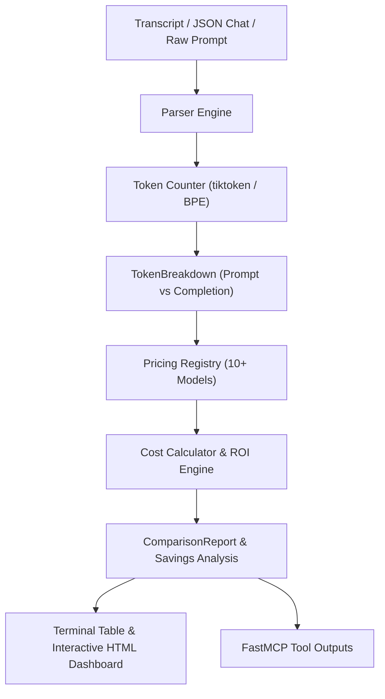

# Token Usage & Cost Calculator

> A multi-provider token usage auditor, context economics evaluator, and cost optimization CLI utility and FastMCP server supporting Google Gemini, OpenAI, Anthropic, and DeepSeek model tiers.

---

## Overview

### Problem Statement & Intended Users
- **Problem**: Deploying multi-agent systems and high-throughput LLM pipelines without token visibility leads to unexpected billing surges. Different providers charge drastically different rates for prompt vs completion tokens, context windows, and cached reads. Teams lack quick, local, deterministic tools to audit conversation transcripts and evaluate cross-model economics.
- **Intended Users**: Agent developers, SRE/DevOps teams, FinOps practitioners, and AI product managers optimizing model selection and inference budgets.

### Key Features
- **Multi-Format Transcript Ingestion**: Parses OpenAI/Anthropic JSON chat message arrays, Antigravity/JSONL multi-step agent transcripts, and raw prompt/Markdown files.
- **Accurate Token Counting**: Leverages `tiktoken` BPE encodings with a deterministic word/character blending heuristic fallback ensuring clean-room reproducibility.
- **Comprehensive Pricing Registry**: Tracks rates per 1M prompt/completion tokens, cached read rates, and maximum context windows across 10 top models:
  - **Google**: Gemini 2.5 Flash, Gemini 1.5 Flash, Gemini 1.5 Pro
  - **OpenAI**: GPT-4o, GPT-4o-mini, o3-mini
  - **Anthropic**: Claude 3.5 Sonnet, Claude 3.5 Haiku
  - **DeepSeek**: DeepSeek V3 (`deepseek-chat`), DeepSeek R1 (`deepseek-reasoner`)
- **Cost & ROI Optimization**: Automatically calculates potential savings percentages and highlights the most cost-effective tier.
- **Interactive Glassmorphism Dashboard**: Generates self-contained HTML reports with responsive cost comparison tables, visual bar meters, and OWASP XSS defense.
- **FastMCP Protocol Integration**: Exposes `calculate_token_cost`, `compare_model_pricing`, and `list_registered_models` directly to agent orchestrators and IDEs.

---

## Technical Stack

- **Language & Runtime**: Python 3.10+ (Tested on Python 3.13)
- **Agent Framework / Protocol**: Model Context Protocol (`mcp` FastMCP)
- **Tokenization**: `tiktoken>=0.7.0` (with deterministic fallback)
- **Modeling & Schema**: `pydantic>=2.0.0`
- **Testing**: `pytest>=8.0.0` (14 clean-room tests passing)
- **External Dependencies**: Zero mandatory API keys; operates completely offline

---

## Architecture & Data Flow



---

## Prerequisites

- Python 3.10 or higher
- `pip` or virtual environment manager
- Zero external API keys needed

---

## Installation & Setup

1. **Navigate to the tool directory:**
   ```bash
   cd tools/token-cost-calculator
   ```

2. **Create and activate a virtual environment (optional):**
   ```bash
   python -m venv .venv
   # Windows:
   .venv\Scripts\activate
   # Linux/macOS:
   source .venv/bin/activate
   ```

3. **Install dependencies:**
   ```bash
   pip install -r requirements.txt
   ```

---

## Usage Instructions

### 1. Evaluating a Multi-Turn Chat History
Audit the bundled conversation sample (`examples/sample_chat.json`):
```bash
python main.py --file examples/sample_chat.json --model gemini-2.5-flash --output-html cost_report.html
```

### 2. Evaluating an Agent JSONL Transcript
```bash
python main.py --file examples/sample_transcript.jsonl --model gpt-4o
```

### 3. Listing All Supported Models
```bash
python main.py --list-models
```

### 4. Running FastMCP Server
```bash
# Verify tool registration:
python mcp_server.py --test

# Run stdio server:
python mcp_server.py
```

---

## Run Inputs & Outputs

### Sample Command
```bash
python main.py --file examples/sample_chat.json --model gemini-2.5-flash
```

### Sample Terminal Output
```
======================================================================
   TOKEN USAGE & COST CALCULATOR
======================================================================
 Target File       : examples/sample_chat.json
 Detected Format   : CHAT_JSON
 Primary Model     : gemini-2.5-flash (Google)
 Total Tokens      : 293 (85 in / 208 out)
 Total Characters  : 1,363
 Primary Cost      : $0.000069 USD
======================================================================

Provider Model Pricing Comparison:
Model                  Provider     Prompt Cost    Comp Cost      Total Cost  
--------------------------------------------------------------------------
  gemini-1.5-flash     Google       $0.000006      $0.000062      $0.000069   
* gemini-2.5-flash     Google       $0.000006      $0.000062      $0.000069   
  deepseek-chat        DeepSeek     $0.000012      $0.000058      $0.000070   
  gpt-4o-mini          OpenAI       $0.000013      $0.000125      $0.000138   
  deepseek-reasoner    DeepSeek     $0.000047      $0.000456      $0.000502   
  claude-3-5-haiku     Anthropic    $0.000068      $0.000832      $0.000900   
  o3-mini              OpenAI       $0.000094      $0.000915      $0.001009   
  gemini-1.5-pro       Google       $0.000106      $0.001040      $0.001146   
  gpt-4o               OpenAI       $0.000213      $0.002080      $0.002292   
  claude-3-5-sonnet    Anthropic    $0.000255      $0.003120      $0.003375   
--------------------------------------------------------------------------
Best Value Tier    : gemini-1.5-flash
Max Savings        : 98.0% ($0.000000 USD vs primary)

[Dashboard] Report written to: cost_report.html
```

---

## Testing & Verification

Run the automated test suite covering pricing tables, BPE tokenization, chat/transcript parsing, multi-model cost analysis, and HTML XSS escaping:

```bash
python -m pytest tests/ -v
```

**Verification Results:**
```
tools/token-cost-calculator/tests/test_analyzer.py::test_analyze_multi_model PASSED
tools/token-cost-calculator/tests/test_analyzer.py::test_custom_comparison_list PASSED
tools/token-cost-calculator/tests/test_dashboard.py::test_cost_dashboard_generation PASSED
tools/token-cost-calculator/tests/test_dashboard.py::test_dashboard_xss_protection PASSED
tools/token-cost-calculator/tests/test_parser.py::test_parse_raw_text PASSED
tools/token-cost-calculator/tests/test_parser.py::test_parse_chat_json PASSED
tools/token-cost-calculator/tests/test_parser.py::test_parse_jsonl_transcript PASSED
tools/token-cost-calculator/tests/test_pricing.py::test_list_supported_models PASSED
tools/token-cost-calculator/tests/test_pricing.py::test_pricing_lookup_case_insensitive PASSED
tools/token-cost-calculator/tests/test_pricing.py::test_cost_calculation_math PASSED
tools/token-cost-calculator/tests/test_pricing.py::test_context_window_fit PASSED
tools/token-cost-calculator/tests/test_tokenizer.py::test_count_empty_text PASSED
tools/token-cost-calculator/tests/test_tokenizer.py::test_count_simple_sentence PASSED
tools/token-cost-calculator/tests/test_tokenizer.py::test_count_longer_paragraph PASSED
============================= 14 passed in 0.14s ==============================
```

---

## Token Considerations & Cost Optimization

- **Zero Run Cost**: The calculator executes 100% locally with zero external API calls.
- **ROI Analytics**: Instantly reveals pricing arbitrage opportunities (e.g., Gemini 2.5 Flash saving up to 98.0% compared to Claude 3.5 Sonnet / GPT-4o for high-throughput pipelines).

---

## Security & Zero Secrets Compliance

- Adheres strictly to the repository's **Zero Secrets Policy**: `.env` and local credentials are fully ignored by `.gitignore`.
- Confines all modifications exclusively to `tools/token-cost-calculator/` and a registration row in `tools/README.md`.
